<!-- Animated header (custom SVG, no external service needed) -->

  

<!-- Typing animation -->
<h3 align="center">
  
</h3>

  
  

---

### 💻 About Me
- 🔭 Currently learning **Software Development**
- 💡 Passionate about writing clean code and solving problems
- 🌱 Always exploring, building and expanding my tech stack
- 🌍 From **Bangladesh** 🇧🇩
- ⚡ Fun fact: `Coffee -> Code -> Bug -> Fix -> Repeat`

---

### 🛠️ Tech Stack

  

  

### 🧰 Tools

  
  
  
  

### 🗄️ Database Management

  
  

---

### 📊 GitHub Stats

  
  

  

---

### 📫 Connect with Me

  
  
  <a href="https://facebook.com/YOUR_FACEBOOK_USERNAME">https://www.facebook.com/share/1F4FQZhmEv/</a>
  

<!-- Animated footer -->

  

